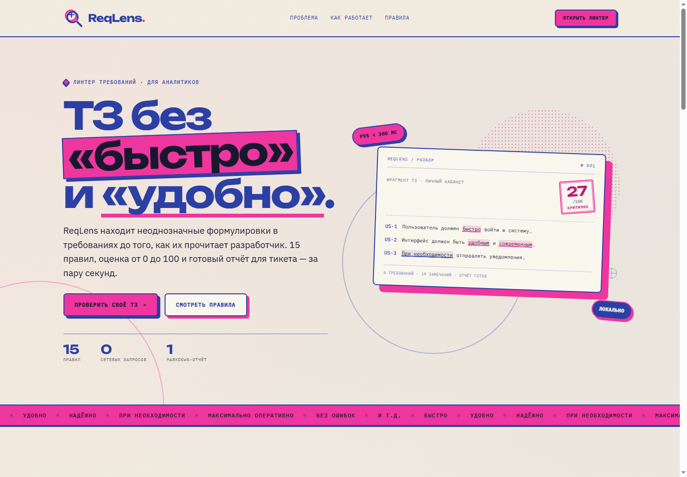
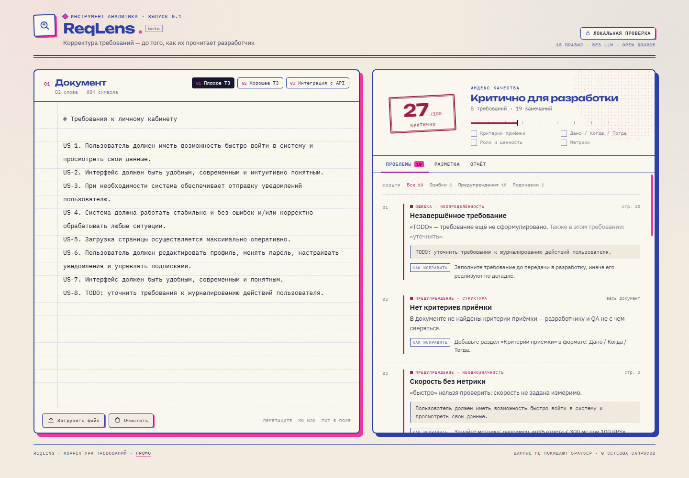
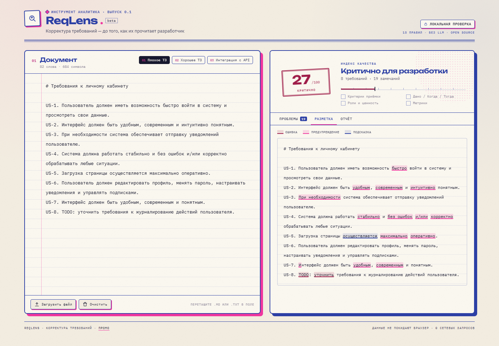
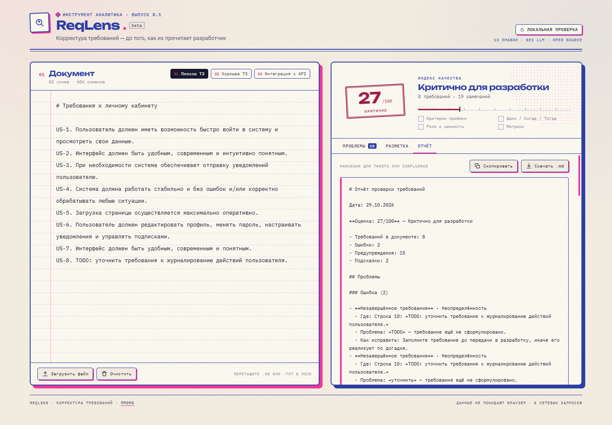

<!--
Служебная заметка для публикации на Habr (в статье не отображается):
- изображения лежат рядом в docs/images/ — загрузите их в редакторе Habr;
- обложка: docs/images/habr-promo.png;
- предлагаемые хабы: «Разработка», «Аналитика», «Веб-разработка»;
- теги: требования, аналитика, линтер, open source, React.
-->

# ТЗ без «быстро» и «удобно»: линтер требований на 15 правил

*Как сделать первичную вычитку требований за секунды — без LLM и отправки документа на сервер.*

**Демо:** [промо-страница](https://ikatsubo13.github.io/ReqLens/) · [линтер](https://ikatsubo13.github.io/ReqLens/app.html) · **Код:** [GitHub](https://github.com/IKatsubo13/ReqLens)



*Промо-страница и линтер — в одном стиле ризографии. Отсюда можно открыть инструмент.*

## Проблема

Почти в каждом ТЗ есть требования, которые невозможно проверить. «Система должна работать быстро». «Интерфейс должен быть удобным». «При необходимости отправлять уведомления». Формально это требования, фактически — пожелания. Разработчик реализует их по-своему, тестировщик напишет тест по-своему, а расхождение всплывёт на демо.

Обычно такие места ловят на ревью. Но ревью — это время аналитика, и оно не масштабируется: документы растут, сроки сжимаются, а формулировки кочуют из тикета в тикет.

Я сделала ReqLens — линтер требований, который делает первичную вычитку за секунды. Вставила текст — получила список проблем с пояснениями, оценку и отчёт, который можно приложить к задаче. Работает в браузере, без регистрации и без отправки документа на сервер.

## Почему не LLM

Первая идея, которая приходит в голову, — отправить ТЗ в языковую модель и попросить найти проблемы. Я сознательно пошла другим путём, и вот почему:

1. **Детерминизм.** Правило срабатывает всегда одинаково. Его можно объяснить, проверить и поправить. Модель может «передумать» между двумя запусками.
2. **Приватность.** ТЗ часто содержат внутренние названия систем и процессов. В ReqLens текст не покидает браузер: нет бэкенда и внешних API.
3. **Бесплатность и скорость.** Нет ключей, лимитов и задержки на генерацию: результат обновляется во время набора.
4. **Прозрачность.** Для каждого замечания видно правило и рекомендацию, а не «модель так решила».

Ограничение подхода тоже честное: правила не понимают смысл. Они не заметят логическое противоречие между двумя требованиями, если оно не выражено словами-маркерами. Это инструмент первичной вычитки, а не замена аналитику. LLM здесь могла бы добавить проверку смысла, но это уже другая история — с другими требованиями к приватности и предсказуемости.

## Что проверяет линтер

В основе — 15 правил. Они сгруппированы по смыслу: от слов-оценок до структуры документа.

| № | Группа | Правило | Что ловит |
| --- | --- | --- | --- |
| 1 | Неоднозначность | Скорость без метрики | «быстро», «оперативно», «максимально» |
| 2 | Неоднозначность | Оценочная формулировка | «удобно», «надёжно», «современно», «без ошибок» |
| 3 | Неоднозначность | Неточное количество | «несколько», «часто», «большинство» |
| 4 | Неоднозначность | Открытый перечень | «и т.д.», «и др.», «и прочее» |
| 5 | Неопределённость | Неуверенное требование | «при необходимости», «по возможности», «желательно» |
| 6 | Неопределённость | Незавершённое требование | TODO, TBD, «уточнить» — ошибки |
| 7 | Стиль | Пассивный залог | «уведомление обрабатывается», «осуществляется» |
| 8 | Атомарность | «И/или» | допускает два разных поведения |
| 9 | Атомарность | Несколько требований в одном | два и более модальных глагола |
| 10 | Атомарность | Составное требование | много действий через «и» |
| 11 | Атомарность | Перечисление в одном пункте | три и более запятых |
| 12 | Дублирование | Возможный дубль | совпадение значимых слов на 75% и более |
| 13 | Структура | Нет критериев приёмки | нет раздела критериев или формата Дано / Когда / Тогда |
| 14 | Структура | Критерии без Дано / Когда / Тогда | есть критерии, но не в проверяемом формате |
| 15 | Структура | Не указаны роль и ценность | нет формата «Как &lt;роль&gt;, я хочу…» |

Для каждого срабатывания есть объяснение и рекомендация. Линтер не просто подчёркивает слово, а предлагает проверяемую формулировку: например, заменить «быстро» на «p95 ответа < 300 мс при 100 RPS».

## Как это выглядит



*Слева — документ, справа — оценка, чек-лист и замечания. В демо-документе 8 требований, 19 замечаний и 27/100.*

Основные элементы интерфейса:

- редактор с проверкой во время набора;
- три демонстрационных документа: плохое ТЗ, хорошее ТЗ и интеграция с API;
- фильтр замечаний по важности: ошибки, предупреждения, подсказки;
- группировка однотипных замечаний, чтобы одна и та же проблема не занимала половину экрана;
- подсветка проблемных мест прямо в тексте;
- Markdown-отчёт для тикета или Confluence.



*Режим «Разметка» показывает, где именно линтер увидел проблему: это удобно при вычитке документа вместе с командой.*



*Отчёт можно скопировать или скачать в `.md` — с замечаниями, рекомендациями и списком того, что уже хорошо.*

## Как считается оценка

Индекс качества — не просто количество замечаний. Требование из одного предложения с пятью проблемами хуже, чем большой документ с теми же пятью проблемами. Поэтому штраф нормируется на число требований:

```text
штраф = 10 × ошибки + 5 × предупреждения + 1.5 × подсказки
индекс = clamp(100 − 6 × штраф / количество_требований, 0, 100)
```

Шкала нужна не для формальной сертификации, а чтобы быстро понять, готов ли документ к работе: «готово к разработке», «почти готово», «требует доработки», «критично».

На демо-документах получается так:

| Документ | Требований | Замечаний | Оценка |
| --- | --- | --- | --- |
| Плохое ТЗ | 8 | 19 | 27/100 |
| Хорошее ТЗ | 5 | 0 | 100/100 |
| Интеграция с API | 5 | 4 | 84/100 |

Плохое ТЗ получает 27 из 100 не потому, что в нём «много слов», а потому, что его требования действительно нельзя проверить: 2 ошибки (незавершённые пункты), 15 предупреждений и 2 подсказки. Хорошее ТЗ с ролями, критериями приёмки и метриками проходит чисто.

## Как устроено внутри

Стек простой: React 19 + TypeScript + Vite, без UI-библиотек и бэкенда. Движок — чистые функции, отдельные от интерфейса:

1. Документ разбивается на требования: списки, нумерованные пункты, `US-1` / `AC-1`, абзацы. Заголовки и названия разделов исключаются.
2. Правила проходят по каждому требованию и возвращают замечания с диапазоном символов.
3. Замечания сортируются, группируются и попадают в оценку, подсветку и Markdown-отчёт.

Правило — это данные плюс функция. Например, группа «скорость без метрики» выглядит так:

```ts
const SPEED_GROUP = {
  severity: 'warning',
  patterns: ['быстр[а-яё]{0,6}', 'оперативн[а-яё]{0,6}', 'максимальн[а-яё]{0,6}'],
  message: (match) => `«${match}» нельзя проверить: скорость не задана измеримо.`,
  hint: 'Задайте метрику: например, «p95 ответа < 300 мс при 100 RPS».',
};
```

Добавить правило — значит добавить группу терминов или отдельную проверку. Для дублей используется Jaccard по значимым словам: если совпадение от 75%, требование помечается как возможный дубль. Для атомарности — эвристики по модальным глаголам, «и/или», запятым и союзам.

Движок отделён от React: `lint()` принимает текст и возвращает `LintResult` с замечаниями, требованиями, оценкой и сигналами. Интерфейс ничего не знает о правилах — он только отображает результат. Это упрощает тесты и добавление новых проверок.

## Тесты, сборка и деплой

Сейчас в проекте 8 тестов движка на Vitest. Они проверяют разбор документов, срабатывание правил, отсутствие ложного срабатывания правила пассивного залога на активной конструкции, обработку TODO как ошибки и оценку демонстрационных документов. Это небольшой, но полезный набор: он фиксирует поведение, которое легко случайно сломать при добавлении нового правила.

Тесты, сборка и публикация запускаются в GitHub Actions. Там же собирается статический сайт: промо-страница на `/`, сам линтер на `/app.html`. Публикация на GitHub Pages происходит автоматически после пуша в `main`.

## Про дизайн

Весь проект — и промо, и линтер — оформлен в одном стиле ризографии: два цвета на тёплой бумаге, офсетные тени, полутоновые точки. Витрина и инструмент выглядят как части одной серии, а не два разных продукта.

В интерфейсе линтера крупные рубленые заголовки Unbounded соседствуют с моноширинным документом. Лист для правок остался: бумажная фактура, синие линейки и розовая линия поля. Оценка сделана в виде штампа, замечания — как маргиналии на полях.

Все шрифты — Unbounded, IBM Plex Sans, IBM Plex Mono — подключены локально через Fontsource. Шрифты лежат в самой сборке: внешних запросов и аналитики нет — это принципиально для инструмента, который обещает не отправлять документы наружу.

## Ограничения

- Эвристики не понимают смысл: противоречия и неполные сценарии останутся на совести человека.
- Ложные срабатывания возможны, поэтому важность замечаний разная, а формулировки можно игнорировать осознанно.
- Словари ориентированы на русский язык; английские термины поддержаны частично.
- Инструмент не заменяет ревью, а сокращает рутину перед ним.
- Пока нет истории проверок, совместной работы и интеграций с Jira или Confluence.
- LLM не используется намеренно: это осознанный компромисс в пользу предсказуемости и приватности.

## Что дальше

Идей несколько: собственные словари под предметную область, трассировка требований и тест-кейсов, интеграция с Jira и Confluence, разбор Git-диффа требований. Ещё одна ветка — опциональный LLM-режим для поиска смысловых противоречий, но только как отдельный слой с явным согласием и понятной политикой хранения данных.

Сейчас важнее собрать обратную связь: какие правила дают больше всего шума, каких не хватает и какие формулировки линтер пропускает.

## Как попробовать

- [Промо-страница](https://ikatsubo13.github.io/ReqLens/)
- [Линтер](https://ikatsubo13.github.io/ReqLens/app.html)
- [Исходный код](https://github.com/IKatsubo13/ReqLens) — MIT, можно форкать и предлагать правила.

Локальный запуск:

```bash
npm ci
npm run dev
```

Промо откроется на `http://localhost:5173/`, линтер — на `http://localhost:5173/app.html`.

```bash
npm test        # тесты движка
npm run lint    # oxlint
npm run build   # production-сборка в dist/
```

## Вместо вывода

Требования — это интерфейс между замыслом и кодом. Чем раньше в них находится двусмысленность, тем дешевле она стоит. Линтер не заменит аналитика, но снимет с него часть рутины и даст повод переформулировать «быстро» во что-то измеримое.

Код открыт, демо работает без регистрации и без отправки данных на сервер. Буду рада замечаниям и идеям новых правил.
